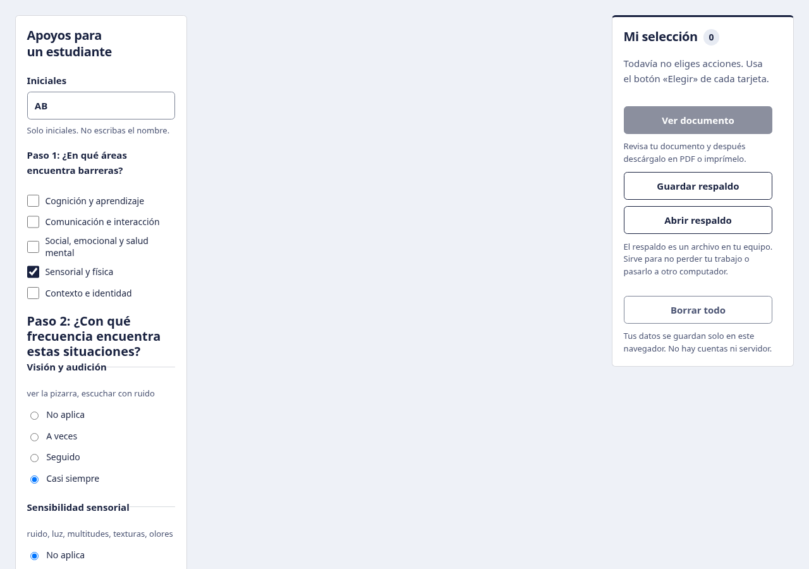
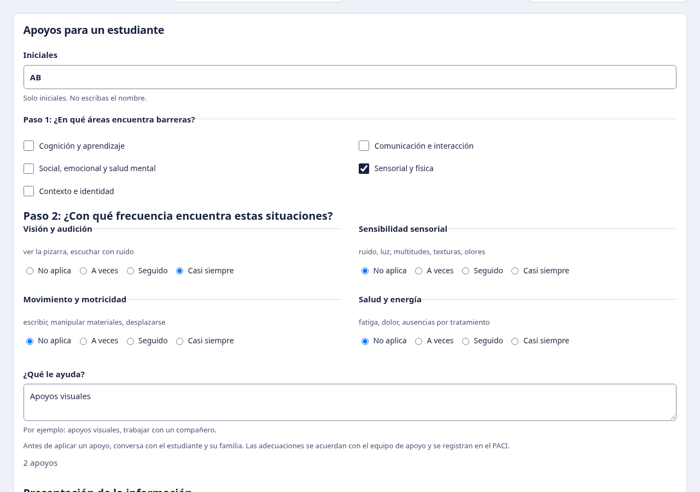
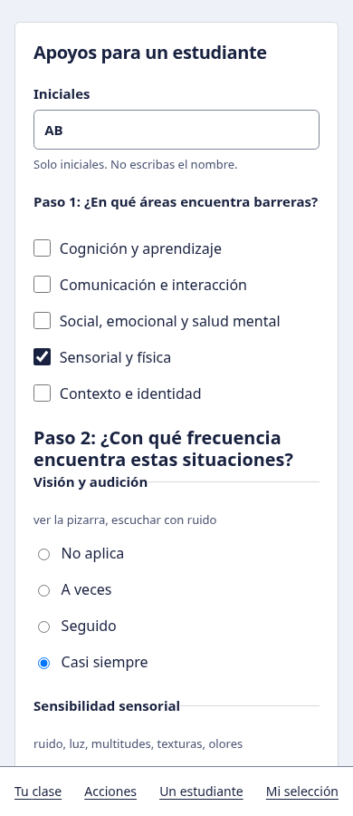

# Corrección visual de «Un estudiante» · PR #8

Capturas de Chromium a 1280 × 900 px (escritorio) y 390 × 900 px (teléfono), tema claro. Mismo estado en ambas versiones: iniciales ficticias AB, área Sensorial y física, Visión y audición en Casi siempre, ayuda «Apoyos visuales», acciones DUA predeterminadas y selección vacía. Antes corresponde al commit `b84960e`; después, a la corrección de distribución en este PR.

Se eligió el ancho completo bajo las columnas principales para que las dimensiones y sus frecuencias se lean con espacio. La grilla de tarjetas es compartida con las acciones DUA. En escritorio, Mi selección sigue fija al desplazarse dentro del bloque superior, sin cubrir la sección del estudiante. En teléfono se conserva una columna.

## Comparación

| Vista | Antes | Después |
|---|---|---|
| Escritorio, página completa | [Antes](antes-escritorio.png) | [Después](despues-escritorio.png) |
| Escritorio, formulario | [Antes](antes-escritorio-detalle.png) | [Después](despues-escritorio-detalle.png) |
| Teléfono, página completa | [Antes](antes-telefono.png) | [Después](despues-telefono.png) |
| Teléfono, formulario | [Antes](antes-telefono-detalle.png) | [Después](despues-telefono-detalle.png) |

En este caso de ejemplo, a 1280 px el ancho de la sección pasa de 272 a 1232 px y su altura de 3514 a 1804 px. La página completa pasa de 9223 a 6373 px. La altura depende del contenido y de las barreras marcadas. A 390 px, el ancho sigue siendo 358 px.

### Escritorio: antes

### Escritorio: después

### Teléfono: antes

### Teléfono: después

## Verificación

Se comprobaron ambos temas en 390, 768, 900, 1024, 1184, 1280 y 1440 px; sin desbordamiento horizontal. En escritorio, las áreas y dimensiones tienen dos columnas, los cuatro radios comparten fila y Mi selección no tapa el formulario. Se comprobaron también ocultación de áreas, navegación de radios con flechas y texto al 200% a 390 px. Axe no detectó infracciones A/AA en ambos temas; esto no acredita conformidad WCAG completa.

Pasaron las pruebas del catálogo, arreglos menores y estudiante, y el flujo de privacidad, selección, respaldo y PDF en Chromium. No se probaron Safari, Firefox, lectores de pantalla ni dispositivos físicos.

## ponytail-review

What this change does: It gives the student section the full page width below the main columns. It puts areas and dimensions in two columns on desktop and shares the card grid with DUA actions.

Looks good. Ship.

Checked CSS placement at all breakpoints, the selection container, hidden areas, keyboard order, shared cards, both themes and the existing data flow. Assumed one person using the static page and current catalog. The initial visual check found the sticky selection covering the new section; its container now limits it to the upper row.

Not checked: Safari, Firefox, screen readers and physical devices.
