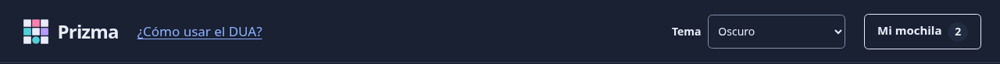

# Tarea 014 · Pasos, Mi mochila y logo M1

Rama: `codex/014-pasos-y-mi-plan`. Base de las capturas «antes»: `5bf7f85`, interfaz de tres columnas. Fecha: 15 de noviembre de 2026.

La página conserva el nombre **Prizma**. Se muestra un paso por vez, a todo el ancho: perfil y necesidades, acciones para todos, y apoyos individuales opcionales. Los enlaces usan `aria-current="step"`, guardan el paso en el estado y usan `#paso-1`, `#paso-2` y `#paso-3`; Atrás y Adelante recuperan el paso y enfocan su título. Una entrada sin hash empieza en 1; un enlace directo válido abre su paso. Los detalles opcionales parten cerrados.

«Mi mochila» permanece en la cabecera sticky y abre un diálogo nativo, lateral en escritorio y de pantalla completa en teléfono. Conserva notas, documento, PDF, impresión, respaldo y borrado. El foco vuelve al botón al cerrar con Escape o «Cerrar». Las acciones se agrupan para el curso y para las iniciales indicadas. Al agregar, el contador se anima durante 250 ms salvo reducción de movimiento y se anuncia «Agregada a tu mochila». «Borrar todo» también devuelve al paso 1.

M1 está en línea como decoración de la cabecera, a 2,75 rem. Las piezas estructurales usan `currentColor`; los tres acentos usan las variables de propósito, incluidas sus variantes claras del tema oscuro. El favicon tiene placa blanca, cuadrados de 3 unidades y separaciones de al menos 2 unidades en un lienzo de 16: supera el mínimo de 1 px real y agranda el círculo a 4 unidades de diámetro. El ícono de app es M1 centrado sobre blanco, de 180 × 180 px.

No se modifican el catálogo, las fuentes, las guías, los avisos, la lógica de recomendación ni la estructura del respaldo. No se agregan dependencias.

## Capturas comparativas

Los ejemplos usan datos ficticios (iniciales AB). Los PNG son capturas de viewport, no una imagen de toda la página. Antes, los tres sectores eran visibles en una misma página: las imágenes se desplazan al sector correspondiente. Después se muestra el paso activo; los pasos 2 y 3 se desplazan a su contenido al navegar. El tema oscuro se documenta para la implementación nueva.

| Vista | Antes, escritorio 1280 | Después, escritorio 1280 | Antes, teléfono 390 | Después, teléfono 390 |
|---|---|---|---|---|
| 1. Tu clase | [Antes](antes-paso-1-1280.png) | [Claro](despues-paso-1-1280-claro.png) · [Oscuro](despues-paso-1-1280-oscuro.png) | [Antes](antes-paso-1-390.png) | [Claro](despues-paso-1-390-claro.png) · [Oscuro](despues-paso-1-390-oscuro.png) |
| 2. Para todos | [Antes](antes-paso-2-1280.png) | [Claro](despues-paso-2-1280-claro.png) · [Oscuro](despues-paso-2-1280-oscuro.png) | [Antes](antes-paso-2-390.png) | [Claro](despues-paso-2-390-claro.png) · [Oscuro](despues-paso-2-390-oscuro.png) |
| 3. Para un estudiante | [Antes](antes-paso-3-1280.png) | [Claro](despues-paso-3-1280-claro.png) · [Oscuro](despues-paso-3-1280-oscuro.png) | [Antes](antes-paso-3-390.png) | [Claro](despues-paso-3-390-claro.png) · [Oscuro](despues-paso-3-390-oscuro.png) |
| Mi mochila | [Antes](antes-mochila-1280.png) | [Claro](despues-mochila-1280-claro.png) · [Oscuro](despues-mochila-1280-oscuro.png) | [Antes](antes-mochila-390.png) | [Claro](despues-mochila-390-claro.png) · [Oscuro](despues-mochila-390-oscuro.png) |

## Marca

Favicon nativo a 16 px: 

Favicon nativo a 32 px: 

## Pruebas

- `node --check app.js`.
- `python3 scripts/validar_catalogo.py`: catálogo correcto; 88 recomendaciones y 36/36 consideraciones DUA.
- Todas las pruebas `scripts/*.cjs`, incluida `probar_pasos.cjs`. Se adaptó el DOM simulado de la guía al traslado de las necesidades al paso 1; se mantienen sus comprobaciones de texto exacto, confirmación, privacidad, foco y almacenamiento bloqueado.
- Chromium con Playwright: navegación mediante enlaces, Atrás/Adelante reales, URL directa y hash incorrecto, entrada sin hash, persistencia y guía abierta desde el paso 3. Foco en el título y desplazamiento bajo la cabecera, cuya altura se mide al cambiar tamaño o texto.
- Elegir desde tarjetas, contador y anuncio; agrupación, notas, quitar la última acción y devolución del foco. Aviso de privacidad sobre el diálogo de mochila y vuelta a la nota; cierre de mochila con Escape y botón.
- Apertura y descarga del PDF, impresión a PDF, guardado y apertura de JSON, recarga con notas conservadas y «Borrar todo». La impresión oculta mochila, cabecera y pasos.
- Vocabulario de parvularia, ambos temas, una columna a 390 px y dos columnas en escritorio. Sin desbordamiento horizontal en los tres pasos ni en mochila a 390 px, también con tamaño de texto de raíz al 200 %. Animación desactivada con `prefers-reduced-motion: reduce`.
- axe-core: sin infracciones automáticas en los tres pasos y el diálogo, en ambos temas, a 1280 y 390 px (16 combinaciones). Esto no sustituye una auditoría manual completa de WCAG.
- Almacenamiento bloqueado en navegador: guía, selección, privacidad, navegación y mochila siguen funcionando. PNG de app y favicon verificados a sus medidas nativas; enlaces locales de esta entrega comprobados.

## ponytail-review

What this change does: It turns the page into three steps and moves selected actions into a native dialog. It keeps the recommendation and export code, and applies the M1 logo with theme colors and new small icons.

Looks good. Ship.

Checked the routing, browser history, focus, hidden sections, nested dialogs, storage failures, selection, backup and document paths. Checked the connected callers, existing tests, mobile layout, larger text, reduced motion and both themes. The expected use remains one person in a browser with a small static catalog; no server, shared state or new dependency is added.

Not checked: screen readers, Safari or Firefox, physical phones and safe-area cutouts, physical printing, or installation of the app icon on iOS. Text scaling was tested through a 200% root font size, not every browser or operating-system zoom setting.
