# Auditoría de marca · Mosaico y Tinta

Fecha: 15 de noviembre de 2026. Tarea 015. Propuestas evaluadas: `mosaico-M1.svg`, `mosaico-M2.svg`, `mosaico-M3.svg` y `tinta-teselas.svg`, sin modificarlas.

## Recomendación y ranking

**Recomiendo M1 como dirección de marca de Mosaico y una Tinta construida con sus cuadrados y círculos.** La pieza circular hace visible una diferencia que pertenece al conjunto, incluso sin los tres colores. M3 es la alternativa más legible para un favicon, pero su matriz de cuatro piezas tiene mayor parecido con Microsoft. Ninguna propuesta está lista para ponerse sin adaptación sobre fondo oscuro.

1. **M1 — dirección recomendada:** mejor relación entre pertenencia, teselas y vocabulario para construir a Tinta. Requiere ajuste óptico a 16 px y una solución de contraste para oscuro.
2. **M3 — alternativa si manda el ícono pequeño:** conserva mejor el rombo a 16 px; necesita mayor diferenciación respecto de Microsoft.
3. **M2 — alternativa modular:** buen bloque compacto y tamaños distintos, pero el bloque grande domina la lectura y se pierde sobre oscuro.
4. **Tinta original — ilustración complementaria:** conservar el concepto de pulpo, trabajar rostro y recorridos de brazos; no usar este boceto como favicon ni como ícono de app.

M1 y M3 **empatan en la suma**. El desempate es una decisión editorial: para una herramienta sobre inclusión y DUA priorizo la coherencia del conjunto logo–mascota. Si la única prioridad fuera reconocer el símbolo a 16 px, elegiría M3. No se presenta una diferencia subjetiva de un punto como una medición de preferencias de docentes.

## Notas de 1 a 5

Escala: **1** no funciona en el uso evaluado; **2** débil, requiere cambios importantes; **3** funciona con límites; **4** sólido con ajustes puntuales; **5** muy sólido en ese criterio. Son juicios de revisión visual apoyados por las pruebas, no resultados de un estudio con usuarios. Los seis criterios pesan igual en la suma. La coherencia de Tinta se evalúa como mascota; la de los logos, como símbolos de la misma familia.

| Propuesta | 1. Legibilidad | 2. Claro / oscuro / grises | 3. Sin depender del color | 4. Originalidad visual | 5. Inclusión y Tinta | 6. Favicon y app | Total / 30 |
|---|---:|---:|---:|---:|---:|---:|---:|
| M1 | 4 | 2 | 5 | 3 | 5 | 3 | **22** |
| M2 | 4 | 2 | 5 | 3 | 4 | 3 | **21** |
| M3 | 5 | 3 | 5 | 2 | 3 | 4 | **22** |
| Tinta original | 2 | 1 | 3 | 2 | 4 | 1 | **13** |

La nota de color mide si **la forma y la organización** sobreviven a cambiar los tonos. No equivale a aprobar contraste sobre oscuro: ese defecto se penaliza en el criterio 2. Tampoco significa que se distingan todos los colores entre sí.

## Método y límites

- Rasterización real de los SVG originales en Chromium, `deviceScaleFactor: 1`, con lienzos de **16 × 16, 32 × 32, 64 × 64 y 180 × 180 px**. Se mantiene el `viewBox`, sus márgenes y la proporción; Tinta queda contenida, no estirada, dentro del cuadrado. En ella 180 px es el tamaño del lienzo, no la altura de su cabeza.
- Los archivos son símbolos sin tipografía. «Legibilidad» significa reconocer piezas, silueta y rasgos, no leer el nombre Mosaico. La palabra en las muestras de pestaña es solo contexto de uso, no una propuesta tipográfica.
- Fondos: claro `#ffffff`, oscuro `#0d1424`. Los SVG se prueban tal como están, sin corregirles los colores para favorecer una propuesta.
- Grises por luminancia relativa Rec. 709, con conversión sRGB → RGB lineal → sRGB. No es una simulación de baja visión.
- Protanopia, deuteranopia y tritanopia: matrices de Machado, Oliveira y Fernandes (2009), severidad 1,0, aplicadas en **RGB lineal**, con recorte al gamut sRGB. También se transforma el fondo de cada muestra. Son aproximaciones para revisión; no describen a todas las personas con daltonismo ni sustituyen pruebas con ellas.
- Se añade una prueba de **una tinta**, conservando las reservas blancas de los ojos. Ayuda a separar la lectura de forma de la preferencia de color.
- Las notas puntúan los originales. Los nuevos bocetos de Tinta se presentan aparte; no se suman como si ya corrigieran el original.

Las matrices, los contrastes, las cajas de arte rasterizadas y los SHA-256 originales están en [mediciones.json](pruebas-015/mediciones.json). Las láminas pueden reducirse al mostrarse en GitHub: para juzgar 16 px hay que abrir el PNG nativo a 100 %, sin ampliarlo.

## 1. Legibilidad por tamaño

La nota global de legibilidad redondea el promedio de las cuatro notas de tamaño.

| Propuesta | 16 px | 32 px | 64 px | 180 px | Qué se observa |
|---|---:|---:|---:|---:|---|
| M1 | 2 | 4 | 5 | 5 | A 16 se reconoce una matriz, pero la diferencia del círculo se debilita. A 32 ya se separan las piezas; a 64 y 180 el mensaje formal es claro. |
| M2 | 3 | 4 | 5 | 5 | El bloque grande sobrevive a 16, aunque las piezas pequeñas y sus separaciones se comprimen. Desde 32 se entiende bien la diferencia de tamaños. |
| M3 | 4 | 5 | 5 | 5 | Cuatro piezas grandes: el rombo permanece más reconocible a 16. Es la mejor reducción, aunque eso no la hace la más original. |
| Tinta | 1 | 1 | 2 | 3 | A 16 y 32 no se reconocen ocho brazos ni expresión. A 64 aparece un personaje pixelado. A 180 se leen ojos y extremidades, pero aún puede parecer un invasor o una medusa. |

M1 y M2 tienen separaciones de 3 unidades en un `viewBox` de 100: a 16 px son **0,48 px** y a 32 son 0,96 px. Es el motivo técnico para preparar un ajuste óptico del favicon, no simplemente reducir la imagen grande. El rombo de M3 ofrece una diferencia de contorno más fuerte que el círculo pequeño de M1. En Tinta, una tesela mide aproximadamente **0,77 px** a 16 y 1,54 px a 32: rostro y recorridos no tienen suficientes píxeles.

### PNG nativos, sin ampliación

| Propuesta | 16 px | 32 px | 64 px | 180 px |
|---|---|---|---|---|
| M1 | [PNG 16](pruebas-015/M1-16.png) | [PNG 32](pruebas-015/M1-32.png) | [PNG 64](pruebas-015/M1-64.png) | [PNG 180](pruebas-015/M1-180.png) |
| M2 | [PNG 16](pruebas-015/M2-16.png) | [PNG 32](pruebas-015/M2-32.png) | [PNG 64](pruebas-015/M2-64.png) | [PNG 180](pruebas-015/M2-180.png) |
| M3 | [PNG 16](pruebas-015/M3-16.png) | [PNG 32](pruebas-015/M3-32.png) | [PNG 64](pruebas-015/M3-64.png) | [PNG 180](pruebas-015/M3-180.png) |
| Tinta | [PNG 16](pruebas-015/Tinta-16.png) | [PNG 32](pruebas-015/Tinta-32.png) | [PNG 64](pruebas-015/Tinta-64.png) | [PNG 180](pruebas-015/Tinta-180.png) |

### Tamaños sobre claro, oscuro y grises

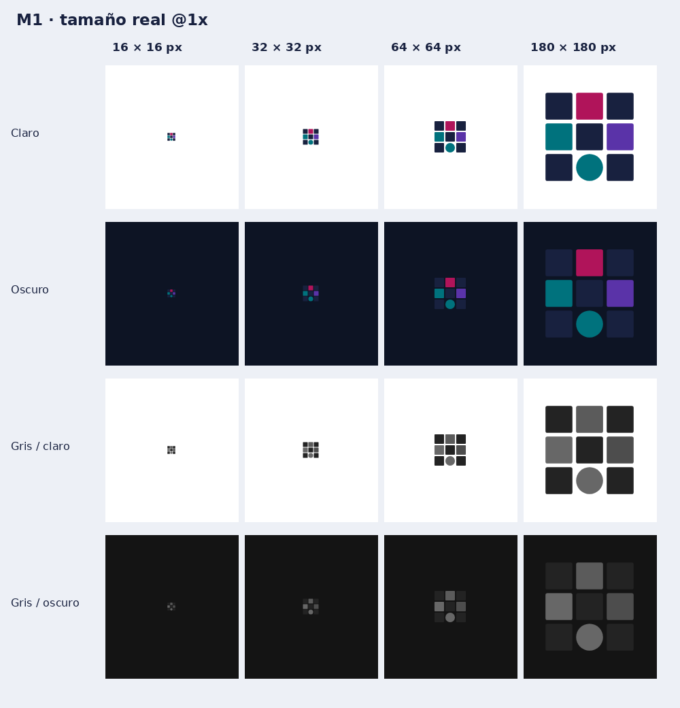

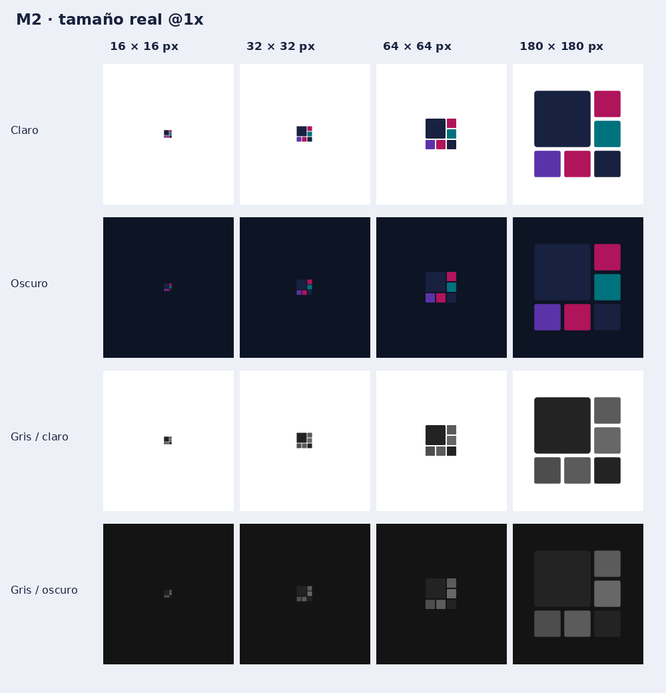

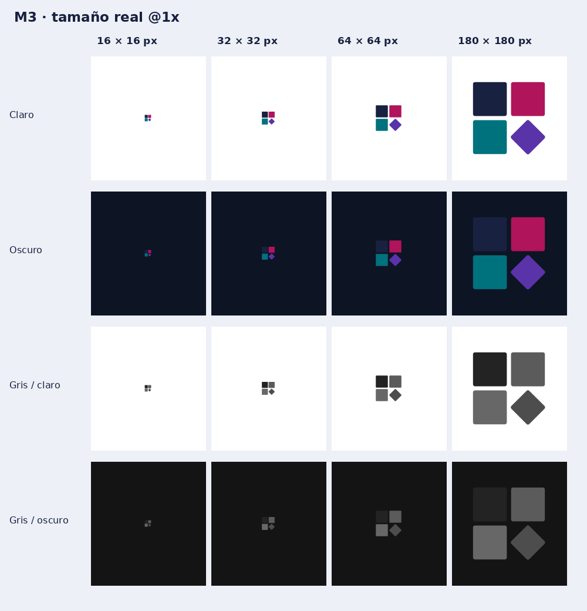

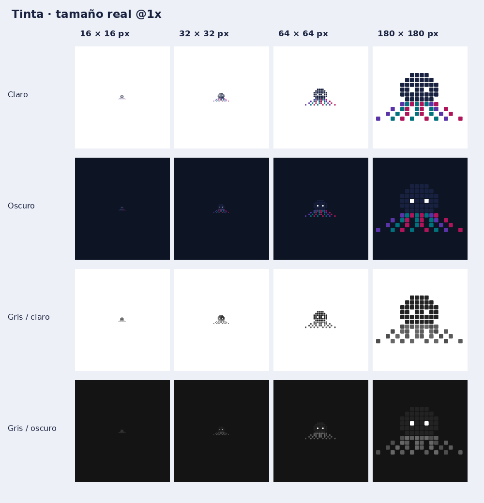

## 2. Fondos y grises

| Tinta del archivo | Contraste sobre blanco | Contraste sobre oscuro |
|---|---:|---:|
| Azul `#18213f` | 15,81:1 | **1,16:1** |
| Magenta `#b0145a` | 6,79:1 | **2,71:1** |
| Verde azulado `#00727d` | 5,67:1 | 3,24:1 |
| Violeta `#5a33a8` | 8,49:1 | **2,16:1** |

- **M1:** sobre blanco se conserva el 3 × 3; sobre oscuro cinco teselas azules casi desaparecen. Quedan cuatro piezas de color y la lectura de conjunto empeora. En grises claros permanece el círculo.
- **M2:** sobre oscuro desaparece visualmente gran parte del bloque dominante, además del cuadrado azul inferior. Es una pérdida estructural, no solo de viveza del color. En grises claros la diferencia de tamaños funciona.
- **M3:** sobre oscuro pierde el cuadrado azul superior izquierdo, pero las otras tres piezas conservan más del signo. En grises claros el rombo sigue siendo distinto.
- **Tinta:** sobre oscuro se pierde el manto, mientras los dos ojos blancos quedan aislados. En grises claros se conserva la cara, pero se dificulta seguir brazos cuyos tonos se parecen.

**Corrección recomendada para la siguiente fase:** preparar una variante para oscuro que use una tinta clara para las piezas estructurales, o contener el símbolo en una placa clara. Mantener separaciones y volver a medir los acentos. Los originales no contienen esa adaptación y no se han modificado en esta entrega.

Los contrastes cuantifican visibilidad; **no se aplica mecánicamente el mínimo de texto de 4,5:1 a todo logo**. WCAG 2.2 contempla una excepción para texto de logotipo o marca. Eso no convierte una marca casi invisible en una buena solución, ni exime al botón o enlace que la contenga de tener nombre accesible y foco visible. Para gráficos que comuniquen información y controles, hay que evaluar además los criterios pertinentes de contraste no textual y uso del color [R6].

## 3. Daltonismo y lectura sin color

| Propuesta | Protanopia y deuteranopia | Tritanopia | ¿Se reconoce sin distinguir los tonos? |
|---|---|---|---|
| M1 | Los acentos cambian y algunos se acercan en apariencia; no debe esperarse que identifiquen tres categorías por sí solos. | Cambia especialmente la relación entre azulado y otros acentos. | Sí, la retícula y el círculo son diferencias geométricas. La limitación de 16 px sigue presente. |
| M2 | Se reduce la diferenciación de ciertos acentos, pero se conserva la diferencia grande/pequeño. | La paleta cambia; la composición no. | Sí, por tamaños y posiciones; no hace falta saber qué cuadrado era magenta. |
| M3 | Los colores dejan de ser una clave fiable para nombrar cada pieza. | Cambian los acentos, pero permanece el rombo. | Sí, y con mayor claridad en pequeño por sus cuatro piezas grandes. |
| Tinta | Los brazos de colores próximos son más difíciles de seguir. | Cambian los grupos cromáticos y la lectura de algunos recorridos. | Parcialmente: la cara sobre blanco se mantiene, pero separar ocho brazos ya era difícil por su geometría. |

Las tres funciones del producto —motivar, presentar y mostrar— seguirán necesitando texto o símbolos en la interfaz. El logo no puede ser una clave cromática suficiente para esas funciones.

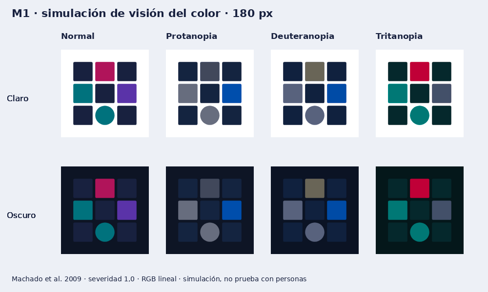

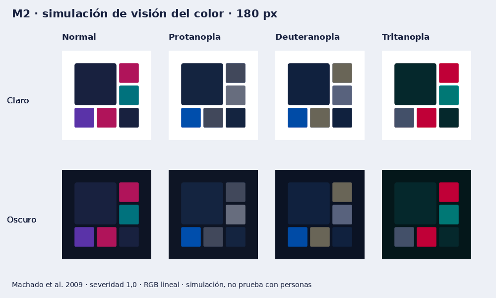

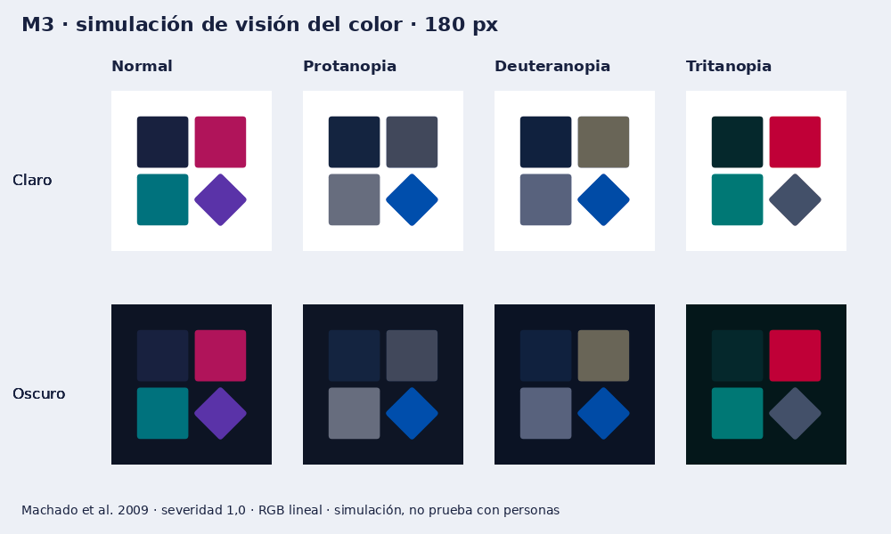

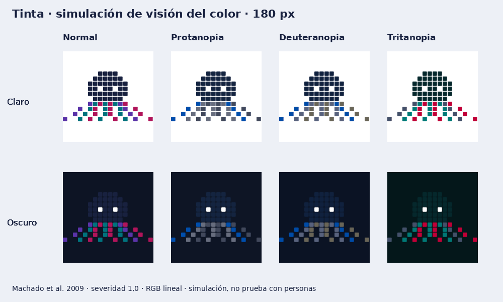

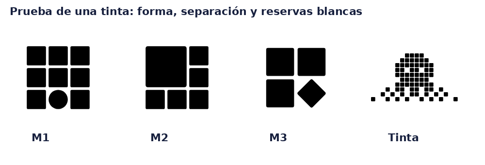

## 4. Originalidad: comparaciones encontradas

Búsqueda web y contraste con referencias primarias, consultadas el 15 de noviembre de 2026. «Riesgo» es una hipótesis de asociación visual, no una tasa medida de confusión, una acusación de copia ni un dictamen de disponibilidad de marca. No se incorporan copias de logos ajenos al repositorio.

| Propuesta | Referente encontrado | Coincidencia concreta | Diferencia y evaluación |
|---|---|---|---|
| M1 | Ícono **apps de Google Material Design** [R1] | Retícula de nueve piezas en tres filas y tres columnas. A 16 px puede parecer un lanzador de aplicaciones. | Google usa nueve cuadrados iguales. M1 incorpora un círculo y otra distribución cromática. Riesgo **medio como signo de interfaz**, menor como logo acompañado por Mosaico. |
| M2 | **Tiles de Windows 8/8.1** [R2] | Un bloque grande y varios pequeños organizados como mosaico digital. | No reproduce una pantalla ni el símbolo de Windows. Riesgo **medio de asociación con panel de apps**, no una coincidencia exacta de logo. |
| M3 | **Microsoft, símbolo de 2012** [R3] | Cuatro piezas de color en distribución 2 × 2; al reducirse domina esa estructura. | El rombo y la paleta diferencian M3, pero sigue siendo la asociación más directa entre los tres logos. Riesgo **medio–alto de asociación**, especialmente sin el nombre. |
| M1 / M2 | **Slack** [R4] | Familia de geometría modular y varios colores; Slack combina piezas redondeadas y círculos. | Su silueta en cruz y disposición son diferentes. Riesgo **bajo por forma**; compartir una paleta geométrica no basta para afirmar confusión. |
| Tinta | Personajes de **Space Invaders / TAITO**, incluido el personaje pulpo [R5] | Manto pixelado, ojos blancos y extremidades descendentes; hay un referente oficial de pulpo pixelado, no solo una semejanza genérica con videojuegos. | Tinta tiene teselas separadas y brazos más largos y coloridos. Aun así, la cara frontal y el cuerpo escalonado producen una asociación **media–alta con un invasor**, sobre todo a 32–64 px. |

No se comprobó registro ni disponibilidad del nombre «Mosaico» en INAPI, dominios o tiendas. Tampoco se hizo una búsqueda inversa exhaustiva de todos los logos existentes. La nota de originalidad se limita a estas comparaciones visuales documentadas.

## 5. Inclusión y relación con Tinta

**M1** expresa con menos explicación que una forma distinta puede ocupar el mismo sistema y escala que las demás. Sus cuadrados y círculo proporcionan las dos piezas necesarias para un pulpo de teselas con ojos circulares. Es la familia más coherente para una herramienta docente sobre DUA.

**M2** muestra diferencias de tamaño que construyen un conjunto, una idea pertinente de diversidad. El bloque grande concentra la atención y ofrece menos variedad formal para el rostro de Tinta; necesita una justificación visual más trabajada para no leerse solo como tablero de aplicaciones.

**M3** reúne cuatro piezas y una orientación distinta. Su economía es útil, pero el concepto de muchas piezas que forman un todo es menos explícito y la tesela girada no aparece en el boceto original de Tinta.

**Tinta** sí comparte la paleta y la construcción por piezas. Sus ocho recorridos se pueden identificar al inspeccionar el SVG, pero eso no equivale a que ocho brazos se reconozcan de inmediato en una imagen pequeña. Sin decir su nombre, la lectura «pulpo» es plausible a 180 px, pero no inequívoca: puede parecer un invasor o una medusa. No se ha hecho una prueba de reconocimiento espontáneo con docentes.

## 6. Favicon e ícono de app

| Propuesta | Pestaña, 16/32 px | App, 64/180 px y máscaras | Decisión |
|---|---|---|---|
| M1 | A 16 se pierde parte del rasgo distintivo; a 32 mejora. | Cuadrado compacto, adecuado sobre placa clara. Los extremos no quedan íntegramente dentro de la zona segura circular de referencia. | Viable tras crear un original óptico de 16 px y variantes de fondo. |
| M2 | El bloque grande se reconoce; las piezas pequeñas se comprimen. | Compacto, pero sus piezas estructurales oscuras se pierden sin fondo claro. | Viable con correcciones; no mejora a M1 en identidad ni a M3 en reducción. |
| M3 | Mejor de los tres a 16 px; rombo más persistente. | Se adapta bien a las máscaras mostradas; la esquina azul aún necesita contraste. | Mejor candidato técnico para microícono, con la objeción de parecido a Microsoft. |
| Tinta | No se reconoce como pulpo a 16/32. | Ocupa casi todo el ancho y sus brazos exteriores se cortan al enmascarar. | Reservar para ilustraciones grandes, no para app ni pestaña. |

La zona segura dibujada es un círculo central de diámetro 80 % del lienzo como referencia de diseño maskable; no es una garantía de aceptación en todas las plataformas. Las muestras son simulaciones de cuadrado, esquinas redondas y círculo, no instalaciones reales en iOS o Android. El archivo de app final también necesitará tamaños y márgenes propios de la plataforma, fuera de esta auditoría.

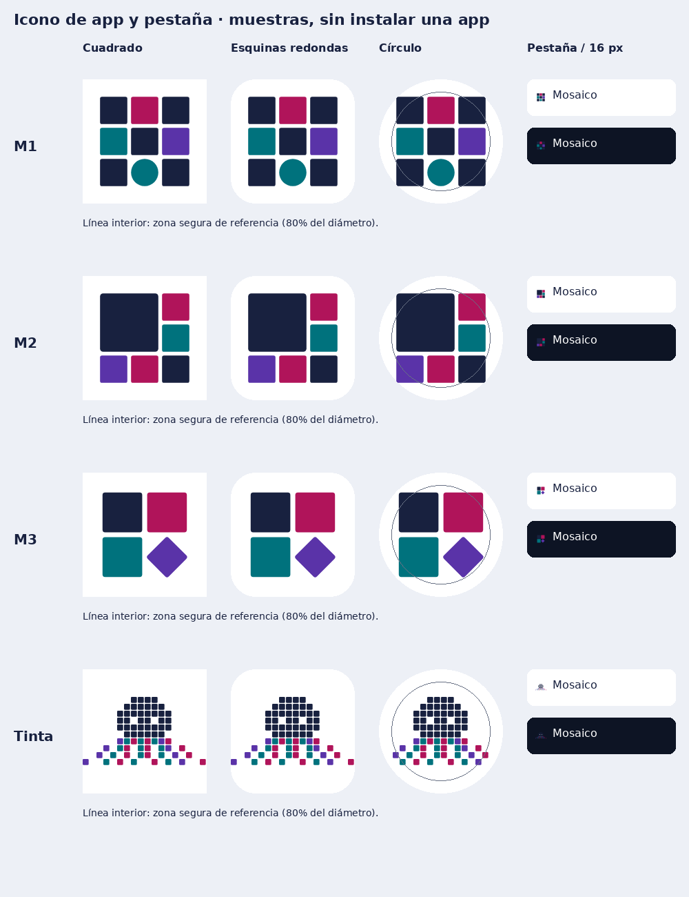

## 7. Dos mejoras concretas de Tinta con las teselas de M1

Se entregan **SVG nuevos y PNG de vista previa**, sin cambiar `tinta-teselas.svg`. Ambos SVG reutilizan exactamente las primitivas de M1: cuadrado de **22 × 22, radio 1,6**, y círculo de **radio 11**. La retícula tiene paso 25. Se mantienen azul, magenta, verde azulado y violeta; el blanco actúa como reserva de los ojos. Las pupilas son instancias escaladas del mismo círculo. No se añaden curvas libres, trazos ni otra familia de piezas.

### A. Manto más abombado y ojos circulares

Cambiar los dos ojos cuadrados por reservas circulares con pupilas, y dar altura al manto con una cima ancha y escalonada. Evita el remate en punta que aproxima un pulpo a un calamar. El objetivo es mejorar el rostro sin convertirlo en una ilustración de formas ajenas al logo.

Esta variante conserva los recorridos abiertos de los brazos del original: **no pretende resolver por sí sola la separación de ocho brazos**. Esa es la mejora B.

[SVG de mejora A](tinta-mejora-a.svg)

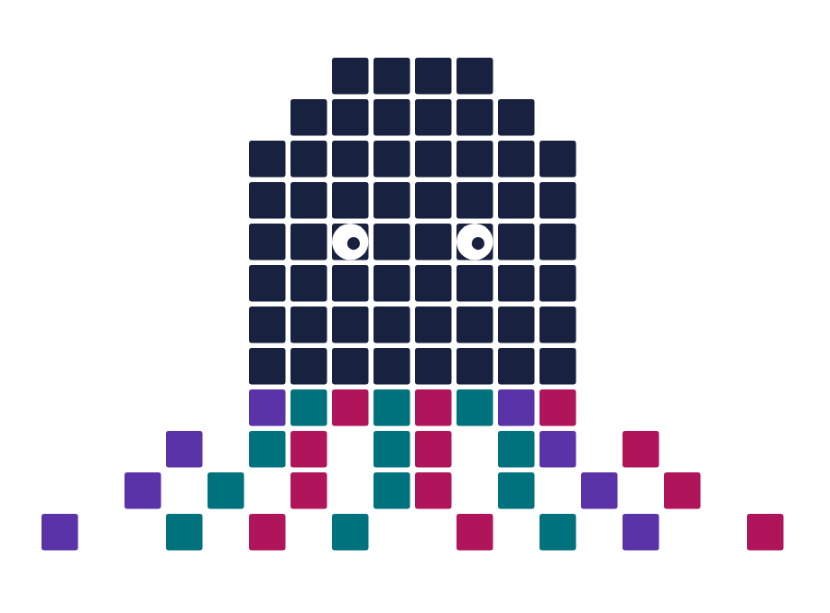

### B. Ocho brazos con raíces separadas y recorridos continuos

Organizar ocho cadenas de teselas con raíces y extremos contables, canales blancos entre ellas y desplazamientos de como máximo una celda por paso. Los extremos exteriores vuelven hacia arriba por escalones: se perciben más como brazos que como confeti que cae. Cada brazo está identificado como grupo en el SVG para verificar y ajustar su recorrido.

Incluye los ojos circulares de A y un manto ancho. Es la dirección que recomiendo desarrollar para la mascota grande. Sigue siendo un boceto: a tamaños pequeños hay demasiadas piezas, y la construcción pixelada todavía merece una prueba comparativa de reconocimiento sin mencionar Space Invaders.

[SVG de mejora B](tinta-mejora-b.svg)

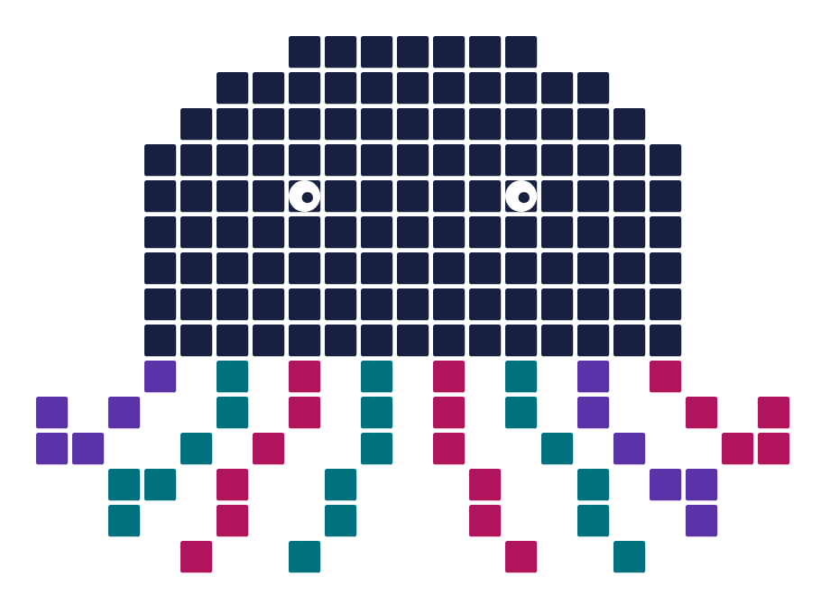

Usaría a Tinta en piezas grandes, inicialmente **a 360 px de ancho o más**, con placa clara o una variante para oscuro pendiente de diseñar. No afirmo que estas mejoras ya resuelvan la pérdida de contraste ni que funcionen como favicon. Antes de elegir el dibujo final, una prueba breve sin pistas debería preguntar «¿qué animal es?» y «¿cuántos brazos distingues?».

Los [bocetos generados A](tinta-exploracion-generada-a.png) y [B](tinta-exploracion-generada-b.png) documentan la exploración con generación de imágenes. No son artes finales ni la referencia de medidas: pueden variar radios, color y forma. La propuesta entregada para construir la mascota está en los SVG y sus PNG derivados, no en esos bocetos rasterizados.

## Fuentes

- **[R1] Google, Material Design Icons, `apps`, SVG oficial:** https://github.com/google/material-design-icons/blob/master/src/navigation/apps/materialicons/24px.svg. Se contrastó su retícula 3 × 3 con M1.
- **[R2] Microsoft Learn, Desktop App Tiles on the Start Screen:** https://learn.microsoft.com/en-us/windows/win32/shell/desktop-app-tiles-on-the-start-screen. Referencia primaria del sistema de tiles de Windows 8; se distingue de un logo único.
- **[R3] Microsoft, Microsoft Unveils a New Look (23-agosto-2012):** https://blogs.microsoft.com/blog/2012/08/23/microsoft-unveils-a-new-look/. Presentación del símbolo y su composición por cuadrados de color.
- **[R4] Slack, Media Kit:** https://slack.com/media-kit. Silueta y guía oficial de su identidad modular.
- **[R5] TAITO, personajes oficiales de Space Invaders:** https://spaceinvaders.jp/characters.html. Incluye el personaje identificado como pulpo.
- **[R6] W3C, WCAG 2.2, contraste y uso del color:** https://www.w3.org/TR/WCAG22/#contrast-minimum; https://www.w3.org/WAI/WCAG22/Understanding/non-text-contrast.html; https://www.w3.org/WAI/WCAG22/Understanding/use-of-color.html.
- **[R7] Machado, G. M.; Oliveira, M. M.; Fernandes, L. A. F. (2009). A Physiologically-based Model for Simulation of Color Vision Deficiency.** DOI https://doi.org/10.1109/TVCG.2009.113; ficha académica https://pubmed.ncbi.nlm.nih.gov/19834201/. Las matrices efectivamente usadas están en `mediciones.json`.
- **[R8] web.dev, Maskable icons:** https://web.dev/articles/maskable-icon. Referencia de la zona central de seguridad; la prueba de esta entrega es geométrica, no una instalación de PWA.

## Comprobaciones y revisión

Se comprobaron los tamaños PNG nativos, las matrices y contrastes guardados, la conservación de los SVG originales, los enlaces locales y las primitivas y ocho grupos de brazos de las mejoras. Todos los archivos agregados están en esta carpeta. No se cambian página, datos, fuentes ni recursos originales de marca.

### ponytail-review

What this change does: It compares four brand proposals at actual icon sizes, on light and dark backgrounds, in grayscale and under three color-vision simulations. It adds two tile-based mascot studies and a source-backed recommendation.

Looks good. Ship.

Checked the original SVG geometry, image dimensions, color calculations, simulation matrices, source links, score totals and new mascot construction. The expected use is a small static audit read on screen. The original SVG files remain unchanged, and the report separates measured contrast from design judgment and the initial image-generation studies from the exact vector drawings.

Not checked: recognition with teachers or people with color-vision deficiency, trademark registration or exhaustive reverse-image search, real app installation, physical screens and print. The original-logo notes do not score the proposed mascot improvements.
